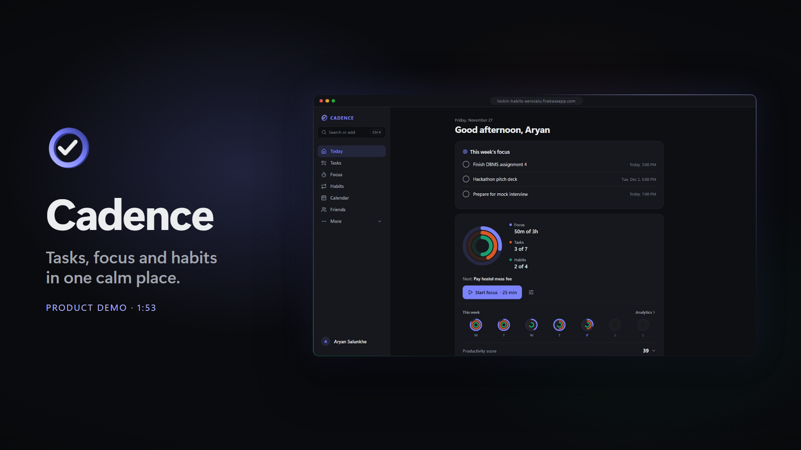

# Cadence

**Tasks, focus and habits in one calm place.**

Cadence is an offline-first productivity app that brings a to-do list, a focus timer and a habit tracker together, so one screen shows how the day is going: three rings for focus, tasks and habits. It works on phone and desktop, installs like an app, and keeps working without signal.

**Live:** https://lockin-habits-aerosalu.firebaseapp.com



## What's in it

- **Today:** focus, task and habit rings with a seven-day view, one Today list for tasks and habits, a productivity score, and the next deadlines.
- **Quick add in plain words:** `gym tomorrow 6pm #fitness !high every mon 45m` becomes a dated, timed, prioritised, repeating task. Ctrl/Cmd+K opens a command palette, and `/`, `N`, `F` and `?` are shortcuts.
- **Tasks:** list and Kanban board with drag and drop (mouse, touch and keyboard), subtasks, estimates, categories, repeats and reusable templates.
- **Calendar:** month and week views of what's due.
- **Focus mode:** 25/5, 50/10, 90/15 or custom sessions linked to a task or habit, breaks, strict mode, generated ambient sound, a wake lock, and a session that survives a reload.
- **Habits:** exact days or a number per week, streaks, completion rates, a history calendar and notes.
- **Plan and review:** a morning plan with a day timeline that warns about overload, an evening review that moves leftover tasks on, and a weekly review that picks next week's focus.
- **Analytics:** day, week and month reports compared with the previous period: focus trends, best time of day, time by category and habit rates.
- **Progress:** XP, levels, badges, daily missions and weekly challenges.
- **Social:** unique usernames, profile photos, friends with a feed and cheers, private groups with weekly leaderboards, and focus rooms where friends run a shared session and see who is focusing, never what on.
- **Your data:** export everything as JSON or tasks as CSV, and delete your account and all its data from Settings.

## How it's built

- **Frontend:** React 19, TypeScript, Vite and React Router, with Motion for animation and dnd-kit for drag and drop.
- **PWA:** a custom Workbox service worker (`vite-plugin-pwa`, `injectManifest`) that precaches the app, plus home-screen shortcuts and a share target.
- **Firebase on the free Spark plan:** Authentication (email and password, or Google), Cloud Firestore and Hosting.
- **Offline first:** Firestore's persistent multi-tab cache applies changes instantly and syncs them later, so screens never wait on the network.
- **No application server:** Firestore Security Rules are the backend. They enforce ownership, friendships, invite codes and value ranges, and are tested against the emulator for owner, friend and stranger cases.
- **Derived, not stored:** streaks, XP, levels, badges and scores are pure functions over stored records (`src/lib/`, tested with Vitest), so they can't drift or be claimed twice.

## Install on your phone

Use the `firebaseapp.com` address above, not `.web.app`: it matches the sign-in domain, which keeps Google sign-in working from the home-screen app.

- **Android (Chrome):** open the link and use **Install app** from the browser menu.
- **iPhone (Safari):** open the link, tap **Share**, then **Add to Home Screen**.

## Develop

Needs Node 20 or later and the Firebase CLI.

```bash
npm install
```

```bash
npm run emulators
```

Then, in a second terminal:

```bash
npm run dev
```

Open http://127.0.0.1:5173. Development always uses the local emulators, so accounts and data are fake and disappear when the emulators stop.

## Check

```bash
npm test
```

```bash
npm run test:rules
```

```bash
npm run lint
```

```bash
npm run build
```

## Deploy

```bash
firebase deploy
```

This builds the app first, then publishes it with the Firestore security rules.

## Set up your own copy

1. Create a project in the [Firebase console](https://console.firebase.google.com).
2. Under **Authentication**, enable **Email/Password** and **Google**.
3. Create a **Firestore** database in production mode.
4. Add a **Web app** and copy its config values into `.env`.
5. Set your project ID in `.firebaserc`, then deploy.

## Limits

- Reminders while the app is closed are built (a scheduled GitHub Actions sender in `sender/`) but not switched on yet.
- A web app can't block other apps or websites.
- Leaderboards use self-reported totals; without a server they can't be verified.
